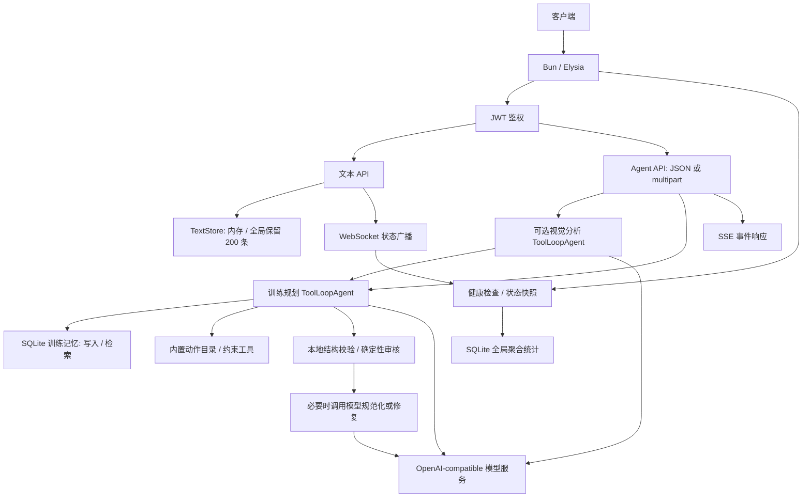

# 架构与性能测试

Agent 单元测试、工作流测试、性能测试及其辅助代码放在 `src/agent/shared/tests/`。API 集成测试放在 `tests/api/`，`bun run test` 会执行两处测试。原有动作目录和交互模式测试已迁入这里。

## 运行

在项目根目录执行：

```bash
bun run test
bun run test:perf
bun run typecheck
```

普通测试覆盖训练记录去重、用户隔离、检索结果、计划审核以及真实 SDK 调用链，默认跳过性能测试。性能测试显式启用，约需 20 秒，输出中位数、P95 和 JSON 报告，默认报告位置为 `/tmp/chatgym-performance.json`。

可以指定报告位置并保留多次结果：

```bash
PERF_REPORT_PATH=/tmp/chatgym-performance-baseline.json bun run test:perf
```

测试使用独立的内存数据库或临时 SQLite 文件，结束后关闭连接并删除临时文件，不读取或修改业务数据库。模型请求和图片下载在 HTTP 边界模拟，执行的是项目实际的 SDK、工具和工作流，不访问外部模型或产生费用。模型测试会临时替换全局 `fetch` 和两个配置变量，结束后恢复；请使用默认串行执行方式，不要加 `--concurrent`。

## 当前架构



`ServerRuntime` 为路由共享 Store 和连接管理器。用户账号和文本在内存中，训练记忆持久化到 SQLite。记忆检索先按用户取最近 80 条，再在 JavaScript 中进行关键词、肌群和时效评分；没有向量数据库。视觉分析先于规划执行，工具调用也可能增加模型往返；格式不合格会追加一次规范化请求，审核不通过会追加一次修复请求。SSE 当前发送工作流进度和每个步骤完成后的文本。

## 覆盖范围

| 文件 | 内容 |
| --- | --- |
| `exercise-catalog.test.ts` | 原有动作推荐、动作名和整数次数校验 |
| `interaction-mode.test.ts` | 原有交互模式识别 |
| `workout-memory.test.ts` | 去重、隔离、排序、事务对照结果一致性和数据规模夹具 |
| `workflow.test.ts` | 正常、格式修正、审核修复、图片及工具链的模型请求次数 |
| `performance.test.ts` | 磁盘写入、查询扩展性、健康 API、文本、广播、模型链、SSE |
| `fixtures.ts` | 临时数据库、固定请求与响应、模拟 HTTP 模型接口 |
| `performance-utils.ts` | 预热、采样、中位数/P95、定时器延迟、JSON 报告 |

## 首轮实测

运行环境：Linux x64，Bun 1.3.5。以下是本机首轮数据，不作为跨机器的固定性能阈值。

| 场景 | 中位耗时 | P95 | 解释 |
| --- | ---: | ---: | --- |
| 磁盘写入 100 条，当前逐条提交 | 665.13 ms | 682.01 ms | 同步写入阻塞主线程 |
| 同样 100 条，外层单事务对照组 | 7.99 ms | 9.10 ms | 本机约快 83 倍，业务写入代码相同 |
| 全局统计，1,000 条 | 0.060 ms | 0.063 ms | 小规模基线 |
| 全局统计，10,000 条 | 0.559 ms | 0.585 ms | 随总记录数增长 |
| 全局统计，100,000 条 | 7.178 ms | 7.463 ms | 相比 1,000 条约慢 120 倍 |
| 用户检索，100,000 条 | 0.247 ms | 0.326 ms | 用户数据固定 100 条，索引效果稳定 |
| 健康 API，100,000 条 | 7.059 ms | 7.171 ms | 端点主要耗时来自全局统计 |
| 正常规划，模拟模型延迟每次 20 ms | 22.59 ms | 23.31 ms | 1 次模型请求 |
| 图片 + 工具 + 格式修正 + 审核修复 | 112.29 ms | 119.44 ms | 5 次串行模型请求，同样每次模拟 20 ms |

SQL 执行计划表明，全局统计扫描覆盖索引，`COUNT(DISTINCT user_id)` 还使用临时 B 树。按用户检索则使用 `(user_id, session_at)` 索引。连续执行 100 次 10 万条规模的状态快照时，本次排队定时器延迟约 715 ms。WebSocket 状态广播和文本提交也会构建这个快照，因此统计代价不仅影响健康检查。

SSE 诊断发现：取消读取响应后，规划模型任务仍完成；在客户端尚未开始读响应时，生产者已能写入 1,000 个文本事件，累计缓冲约 1.13 MB。本次模拟 40 ms 模型请求中，首个 `text` 事件约在 49 ms、最终事件约在 50 ms 出现，与当前按模型步骤完成后才发文本的实现一致。

首轮测试还发现一个功能问题：multipart 上传会转成 `data:image/...;base64,...`；当时安装的 SDK 在工作流中尝试下载该地址并报 `URL scheme must be http or https, got data:`。首轮报告的 `diagnostics.dataUrlInput` 单独记录这个失败，成功的图片流程使用模拟 HTTPS 图片进行测量，避免把失败退出的速度误认为成功处理速度。升级 Bun 1.4.2 时已修复该兼容问题：视觉消息将 base64 data URL 转成图片字节传给 SDK，API 集成测试覆盖 JSON 和 multipart 图片输入。

## 优化优先级

1. **批量写入使用事务。** 对照组已验证同样的写入与去重语义可以大幅减少磁盘提交开销。进一步评估 WAL 时应单独比较，不能把事务和日志模式的收益混在一起。
2. **移除高频路径中的全局聚合扫描。** 可维护统计表或使用带失效策略的摘要缓存，让文本提交、广播和健康检查不必每次扫描所有训练记录。
3. **将取消信号传递到模型工作流。** 客户端断开后中止视觉、规划、规范化和修复请求，并给 SSE 增加队列上限或背压处理。
4. **减少不必要的模型往返。** 控制工具次数、提高首版结构输出成功率，并用实际模型流式 API 改善首个文本到达时间。保留审核逻辑，收益应通过真实请求另行验证。
5. **图片 data URL 的 SDK 兼容问题已修复。** JSON 和 multipart 上传图片的分析与规划流程均由 API 集成测试验证。

默认只保留 200 条文本时，文本查询耗时约 0.002 ms；动作推荐约 0.181 ms。当前证据更支持先处理磁盘提交和全局统计。2 万条文本保留量只是扩展性探测，不能视为当前线上配置。WebSocket 使用模拟 socket，广播数字不包含真实网络发送和慢客户端代价。

## 测量边界

同步微基准先预热再取 20 个样本；磁盘写入先预热两条路径，再交替顺序取 20 个样本；模型工作流先预热 SDK，每条路径取 10 个样本。为减少计时噪声，快速操作会组成批次，报告的每操作中位数和 P95 是**每批平均耗时**的分布，不是单次请求尾延迟。磁盘写入的一个操作指完整的 100 条批次。

性能测试不使用固定毫秒值或加速比判定通过，只断言数据和请求次数，避免机器负载导致误报。报告另行保存定时器延迟、SQL 执行计划、模拟模型等待时间、请求字节数与 SSE 行为，支持优化前后比较。定时器延迟包含调度开销；API 测试调用 `app.handle()`，包含处理和响应读取，但不包含监听端口和网络传输。模型延迟是人为设置，不能替代真实供应商延迟或线上并发压测。

数据库夹具通过 `Reflect.get(store, 'db')` 访问连接，仅用于关闭连接、查询计划及事务对照。若 Store 内部连接字段改名，需同步更新夹具。
